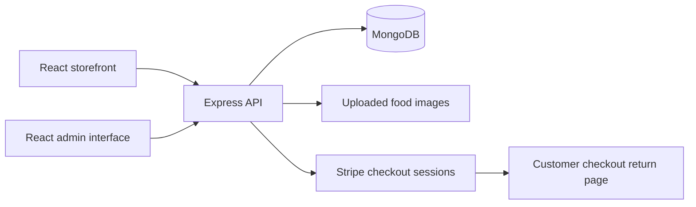

# Tomato — Food Delivery App

**A food-ordering workflow, from browsing a menu to managing orders.**

Tomato combines a React storefront, a separate React administration interface, and an Express API backed by MongoDB. It is a full-stack project for understanding how catalog, account, cart, and order features fit together.

[Setup](#run-locally) · [Architecture](#architecture) · [Source guide](#source-guide)

## What it helps with

Customers need one flow for choosing food, managing a cart, and checking their orders. Operators need a separate interface for maintaining the menu and order statuses. This project implements those related workflows in three applications.

- **Storefront:** food browsing, login/registration, cart, checkout, and order history.
- **Administration:** add and remove food items, list the catalog, and update order statuses.
- **API:** user accounts, cart persistence, image uploads, orders, and Stripe checkout-session creation.

## Existing demo links

- [Customer interface](https://food-delivery-app-coral-six.vercel.app/)
- [Administration interface](https://food-delivery-app-f9h5-a8gp4bo1g-balaji91221s-projects.vercel.app/)

These are the project's existing deployment links; service availability is independent of this source repository.

## Run locally

Use Node.js/npm, a MongoDB database, and your own Stripe test credentials. Download the repository source, then configure `Backend/.env`:

| Variable | Purpose |
|---|---|
| `MONGODB_URI` | MongoDB connection URI |
| `JWT_SECRET` | Account token signing secret |
| `STRIPE_SECRET_KEY` | Stripe key for checkout-session creation |
| `FRONTEND_URL` | Customer UI origin used for checkout return URLs |

Set `VITE_API_URL=http://localhost:4000` in each frontend's `.env`. Start each application in a separate terminal, beginning at the repository root:

```bash
cd Backend
npm install
npm start
```

```bash
cd Frontend
npm install
npm run dev
```

```bash
cd admin
npm install
npm run dev
```

The API uses port **4000**. Open the distinct URLs printed by the two Vite processes, and make `FRONTEND_URL` match the customer UI URL. Configure provider credentials locally; do not reuse somebody else's service configuration.

## Architecture



Routes dispatch to controllers; Mongoose models store users, food, and orders. The two UIs share the API while owning separate navigation and presentation.

## Source guide

| Directory | Role |
|---|---|
| [`Frontend/`](Frontend) | Customer application |
| [`admin/`](admin) | Catalog and order-management UI |
| [`Backend/routes/`](Backend/routes) | `/api/user`, `/api/food`, `/api/cart`, `/api/order` |
| [`Backend/controllers/`](Backend/controllers) | Account, catalog, cart, and checkout logic |
| [`Backend/models/`](Backend/models) | Database models |

## Development scope

Use Stripe test mode when exploring the checkout flow. Before adapting this project for a live store, review authorization on administrative routes and the payment-verification implementation against the intended deployment.
